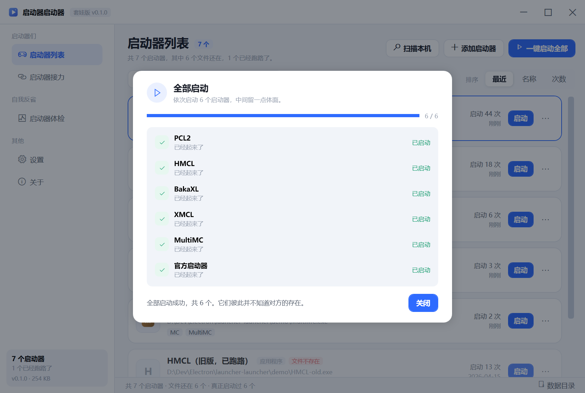

# 启动器启动器

> 一个专门用来启动启动器的启动器。


总有人热衷于给 Minecraft 开发启动器，于是世界上出现了一大堆没什么用、但确实存在的启动器。
它们各自占着一个文件夹，各自觉得自己很重要，各自需要你记住它在哪里。

这个软件解决不了这个问题。它只是让你在一个地方看到全部的它们，然后一键把它们全部叫起来。

顺便一提，它自己也是一个启动器。这一点它并不打算反省。

---

## 它到底能干什么

| 能力 | 说明 |
| --- | --- |
| 录入启动器 | 手动添加 `.exe` / `.jar` / `.lnk` / `.bat`，或者直接把文件拖进窗口 |
| 自动扫描 | 在桌面、下载、文档、开始菜单、各个盘的游戏目录里找可疑的「启动器」并让你勾选收录 |
| 一键启动 | 单个启动，或者一次性把全部启动器叫起来（可同时 / 可逐个带间隔） |
| 启动器接力 | 把多个启动器排成一条链：等上一个退出、同时开、或间隔 N 毫秒，一键跑完整条 |
| 启动器体检 | 按收录数量、失联比例、启动次数算一个健康指数，再附一段医师意见 |
| 千万别点 | 启动它自己，一层层套到第 10 层，最后以 `StackOverflowException` 收场（首页右上角红色按钮） |
| 托盘 / 自启 | 关到托盘、开机自启、启动后自动最小化，让它比浏览器还积极 |





## 启动器体检

左边是分数，右边是八项指标，下面是医师意见。报告可以一键复制成纯文本，拿去吓唬别人。


## 千万别点

首页右上角有个红色的按钮，写着「千万别点」。它干的事是：**启动这个启动器它自己**。

被启动的那一只会再启动一只，那一只又会再启动一只……每一层都往右下挪一点，标题栏上标着「第 N 层套娃」。
套到第 10 层，最里面那只不再往下套了，而是弹出一张 `StackOverflowException`：

> 启动器启动器 已经套了 10 层。
> 这一层没有再启动下一层，因为再往下就不是玩笑，是内存。
> （真正的 StackOverflow 会让进程当场消失。这里给你一个体面的终点。）

然后有两个按钮：**结束这场闹剧**（把这一窝十只全部关掉）和 **留着它们**（只关掉当前这一层，让前九只继续挂着）。


点之前会先弹一次确认：「我就要点」/「算了，我怕」。确认框是红的，按钮也是红的，警告图标也是红的。
——毕竟这是一个关于「总有人要再做一个启动器」的玩笑，总得给点仪式感。

## 界面


## 技术栈（以及为什么不用 Electron）

- **WPF / .NET Framework 4.8 / 单文件**
- 整个程序压在一个 `exe` 里，**259 KB**，不需要额外安装运行时
  （Windows 10 和 Windows 11 自带 .NET Framework 4.8）
- 没有用 Electron，不是因为它不好，而是因为这个玩笑不需要 120 MB 的诚意

体积实测对比（同一个玩笑的不同实现方式）：

| 方案 | 体积 | 结论 |
| --- | --- | --- |
| WPF `net10.0` 自包含单文件（压缩） | 61.8 MB | 直接超预算 |
| **WPF `net48` 单文件（本方案）** | **0.25 MB** | 比要求小两个数量级，本身就是个梗 |
| Electron | 约 120 MB | 节目效果有了，预算没了 |

## 编译

需要 .NET SDK（装了 `Microsoft.NETFramework.ReferenceAssemblies` 的引用程序集就能在任意 SDK 上编译 `net48`）：

```powershell
dotnet build -c Release
# 产物：bin\Release\net48\LauncherLauncher.exe
```

或者一个脚本搞定打包：

```powershell
powershell -ExecutionPolicy Bypass -File tools\publish.ps1
# 产物：publish\LauncherLauncher.exe（单文件）
# 加 -Portable 会在旁边放一个 portable.txt，数据改存到 exe 旁边的 Data 目录
```

## 数据放在哪

- 默认：`%APPDATA%\LauncherLauncher\data.json`（写入前会把旧文件备份成 `data.backup.json`）
- 便携模式：`exe` 同目录下放一个 `portable.txt`，数据改存 `Data\data.json`
- 出问题会写 `crash.log` 到同一个目录

## 仓库里还有什么

```
LauncherLauncher.csproj    工程文件（net48 + WPF，体积就是这么来的）
app.manifest               asInvoker + PerMonitorV2 DPI + longPathAware
Styles\Theme.xaml          全部配色、按钮、输入框、滚动条、菜单样式
Models\                    LauncherEntry / LaunchChain / AppSettings(数据库)
Services\                  Store(读写) / AppState / IconLoader / LauncherRunner / Detector / ReportBuilder
Views\                     五个页面 + 五个弹层（录入、扫描、接力编辑、批量启动、通用确认）
demo\                      6 个假装自己是启动器的 WinForms 占位程序（PCL2/HMCL/BakaXL/XMCL/MultiMC/官方）
tools\                     图标生成、占位启动器生成、种子数据、截图/点击/UIA 辅助脚本、打包脚本
docs\                      README 用的截图
```

`demo\` 里那六个 exe 是本项目自己编的假启动器：点开会弹一个写着「PCL2 已经启动，正在假装加载版本」的对话框。
它们存在的意义是让这个软件的截图里有东西可启动——毕竟你真的装了六个启动器的话，也不会需要这个软件。

想看演示数据的话：

```powershell
powershell -ExecutionPolicy Bypass -File tools\seed-demo.ps1   # 写入 7 条记录 + 2 条接力 + 失联项
powershell -ExecutionPolicy Bypass -File tools\make-demo.ps1   # 重新生成 demo 里的假启动器
```

想清空：设置 → 数据 → 清空启动器列表。

## 一些细节

- 扫描只在本机进行，结果不会上传。这一点比某些启动器强。
- 扫描会跳过 `Windows`、`WinSxS`、`node_modules`、`$Recycle.Bin` 这类目录，也过滤 `msedge_pwa_launcher`、
  `LauncherRSXRuntime` 这种名字里有 launcher 但其实和 Minecraft 无关的东西——不然「找到 28 个疑似启动器」里
  有 27 个是浏览器。
- 启动 `.jar` 时会自己去 `JAVA_HOME`、`PATH`、`.minecraft\runtime` 和常见安装目录里找 `javaw.exe`。
  一个 Java 启动器没有 Java，就像一个启动器没有启动器。
- 它会拒绝启动它自己（「启动器启动器不能启动它自己。这会让宇宙形成一个环。」）。
- 关掉窗口默认是退出；设置里可以改成缩到托盘。

## 已知的诚实

- 它不能帮你决定到底该用哪个启动器。
- 它不能减少你硬盘上的启动器数量，只会让它们看起来更有组织。
- 体检分数是编的，但它关于你的判断大概率是真的。
